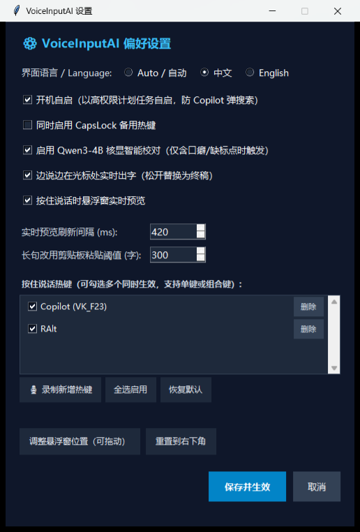

<div align="center">


**Hold a hotkey and talk with live overlay preview, then insert polished text on release. Runs locally on your iGPU: offline, free, with optional live cursor typing.**

[简体中文](README.md) · **English**


</div>

---

## 📸 Screenshots

<table>
<tr>
<td width="50%" align="center"><b>Live preview · optional live cursor typing, polished on release</b><br></td>
<td width="50%" align="center"><b>Tray menu: status at a glance</b><br></td>
</tr>
</table>

> Left: with **Type at the cursor while speaking** enabled — dictating "hello hello hello, 今天天气怎么样？" into an input box. Text updates live and the overlay shows "已重整上屏 (368 ms)" (final text applied in 368 ms).
> Right: the tray menu shows the online status of both backends, plus live-typing toggle, one-click recovery, and start/stop/restart.

<table>
<tr>
<td width="50%" align="center"><b>Settings (English)</b><br></td>
<td width="50%" align="center"><b>设置窗口（中文）</b><br></td>
</tr>
</table>

> The tray menu, settings window and overlay messages come in English and Chinese. Switch under **Interface language** in Settings; the default follows your Windows display language.

> [!NOTE]
> Only the interface is bilingual. Speech recognition is run with the language fixed to Chinese (`lid=zh`), and the polishing prompt and filler-word rules are written for Chinese text. Log files are also written in Chinese.

## 💡 Use cases

**① Mixed Chinese/English dictation into any app**
Hold the hotkey in an IDE, terminal, browser, or chat app. Live recognition streams in the overlay, and the final text inserts on release (short phrases `<= 24` chars via `SendInput` Unicode, longer text via instant clipboard paste; or enable live cursor typing from the tray).

**② Filler-word removal and punctuation** (actual output from the local Qwen3-4B)

| What you said (raw ASR) | What gets typed |
|---|---|
| 嗯那个就是帮我把今天的 api 接口文档发到群里然后顺便 check 一下数据库有没有报错 | 那个就是帮我把今天的 api 接口文档发到群里，然后顺便 check 一下数据库有没有报错。 |
| 呃明天下午三点开个会啊讨论一下 kubernetes 集群升级的事情 | 明天下午三点开个会讨论一下 kubernetes 集群升级的事情。 |
| 我想问一下这个 fakeTCP 的握手流程是不是有问题 | 我想问一下这个 fakeTCP 的握手流程是不是有问题。 |
| 帮我把这个 pull request merge 到 main 分支然后部署一下 | 帮我把这个 pull request merge 到 main 分支然后部署一下。 |

English and technical terms (`api`, `check`, `fakeTCP`, `kubernetes`, `pull request`, `merge`) are kept as spoken. Only filler words and punctuation are touched.

**③ Pick your own hotkey**
Record any single key or combo in Settings: the `Copilot` key, `RAlt`, `CapsLock`, `Ctrl+Space`, and so on. Tick several to enable them at the same time.

**④ Stays up for long sessions**
The mic reconnects after sleep/wake, crashed backends are restarted automatically, and the tray has a one-click recovery if anything gets stuck.

---

## ✨ Features

| | |
|---|---|
| ⚡ **Live preview · optional live typing** | Incremental ASR every ~420 ms in the overlay, instant final insert on release (enable live typing at cursor anytime in tray) |
| 📋 **Direct typing & instant paste** | Up to 24 chars use Win32 `SendInput` Unicode (clipboard untouched); longer text uses instant clipboard paste |
| 🧠 **Local iGPU dual engine** | SenseVoice (DirectML) for ASR, Qwen3-4B (Vulkan) for on-demand polishing. No discrete GPU needed |
| ✂️ **Restrained AI polish** | Runs only when fillers or missing punctuation are detected. No rewording, English terms untouched |
| ⌨️ **Win11 Copilot key** | Swallows `Copilot (F23)` so search doesn't pop up; multi-hotkey support and UAC elevation for elevated windows |
| 🛡️ **Self-healing & hot-memory pin** | Pins 448 MB CPU hot working set across tray/ASR/LLM, async tray updates, mic auto-reconnect, backend watchdog |
| 🌐 **Bilingual UI** | Tray, settings and overlay in English or Chinese. Switch in Settings; defaults to your Windows language |

## 🆚 Comparison

| | Cloud subscription tools | Typical offline tools | **VoiceInputAI** |
|---|:---:|:---:|:---:|
| Privacy / cost | Uploaded to cloud · paid | Local · free | **Local · free** |
| When text appears | After you finish | Pasted all at once on release | **Instant on release (optional live typing)** |
| How text is inserted | Often via clipboard | Often via clipboard | **`SendInput` (`<= 24` chars) · instant paste** |
| Acceleration | Cloud | Mostly CPU / CUDA | **iGPU: DirectML + Vulkan** |
| LLM polishing | May rewrite your meaning | Manual trigger | **On demand, minimal edits** |

## 🔧 How it works

```text
Hotkey down ─ WH_KEYBOARD_LL swallows the system key event
  │
  ├─ While speaking (~420 ms) ─▶ SenseVoice (:18081) ─▶ overlay preview (optional incremental cursor typing)
  │
  └─ Hotkey up ─▶ final recognition
                   ├─ already clean ─────────────────────────┐
                   └─ fillers / no punctuation ─▶ Qwen3-4B (:18082) ─┴─▶ direct type / paste (or block-select replace)
```

<details>
<summary><b>Responsiveness & live-typing implementation details</b></summary>

- **Previews never block the final pass**: preview and final passes use dedicated HTTP sessions plus a non-blocking lock, so final recognition on release never queues behind previews.
- **Append-only while held (live cursor mode)**: no Backspace is sent while modifiers are held; non-punctuation tail anchors with 1–2 char revision backtracking prevent Electron `Win+Shift+Backspace` shortcuts or duplicate characters.
- **Fast block replacement**: for long replacements above the paste threshold in desktop editors/browsers, `Shift+Up` line jumps + `GetClipboardSequenceNumber` probes shrink multi-line selections cleanly (safely falling back to batched `Shift+Left` in terminals).
- **Load resilience & PortAudio safety**: pins a `448 MB` (`96 / 128 / 224 MB`) hard minimum CPU working set across tray/ASR/LLM processes, offloads tray icon updates asynchronously, and serializes PortAudio open/close/reinit under an `RLock` + cooldown to prevent shutdown/concurrency faults.
- **No DirectML stalls & overlay bubble**: `dml_pad_to=30` fixed-length padding with two-pass warm-up; `WS_EX_NOACTIVATE` overlay never steals focus, drags smoothly, and remembers its position.

</details>

## 🚀 Quick start

**1. Install dependencies**

```bash
pip install -r requirements.txt
```

**2. Download models and frameworks**

| Component | Download | Where to put it |
|---|---|---|
| 🎙️ SenseVoice-Small | [GitHub](https://github.com/FunAudioLLM/SenseVoice) · [ModelScope](https://modelscope.cn/models/iic/SenseVoiceSmall) · [HF](https://huggingface.co/FunAudioLLM/SenseVoiceSmall) | Source model for ONNX export |
| 📦 SenseVoice FP16 ONNX | Export with [SenseVoice-ONNX](https://github.com/HaujetZhao/SenseVoice-ONNX),<br>or extract from a [CapsWriter-Offline release](https://github.com/HaujetZhao/CapsWriter-Offline/releases) bundle | `models/sensevoice/`<br>`SenseVoice-Encoder.fp16.onnx`<br>`SenseVoice-CTC.fp16.onnx`<br>`tokenizer.bpe.model` |
| ⚙️ ONNX Runtime DirectML | [PyPI](https://pypi.org/project/onnxruntime-directml/) · [GitHub](https://github.com/microsoft/onnxruntime) | `pip install onnxruntime-directml` |
| 🧠 Qwen3-4B-Q4_K_M | [HF](https://huggingface.co/Qwen/Qwen3-4B-GGUF) · [direct link](https://huggingface.co/Qwen/Qwen3-4B-GGUF/resolve/main/Qwen3-4B-Q4_K_M.gguf) · [ModelScope](https://modelscope.cn/models/Qwen/Qwen3-4B-GGUF) | `models/Qwen3-4B-Q4_K_M.gguf` (optional) |
| 🔥 llama.cpp (Vulkan) | [Releases](https://github.com/ggml-org/llama.cpp/releases), pick `llama-*-bin-win-vulkan-x64.zip` | `bin/llama/` |

<details>
<summary>Command-line download reference</summary>

```bash
pip install modelscope
modelscope download --model iic/SenseVoiceSmall
git clone https://github.com/HaujetZhao/SenseVoice-ONNX.git
modelscope download --model Qwen/Qwen3-4B-GGUF Qwen3-4B-Q4_K_M.gguf --local_dir ./models
```

</details>

**3. Run**

Double-click [`start.bat`](start.bat) (automatically prompts UAC elevation so global hotkeys work across elevated windows and working-set pinning succeeds, while cleaning up any stale processes on restart; [`start_tray.bat`](start_tray.bat) remains for standard non-elevated launch). Once the tray icon turns green, hold the hotkey and talk. Right-click the tray icon → **Settings** to record hotkeys, switch the interface language, toggle live cursor typing, or enable elevated auto-start.

## 📁 Layout

```text
voice_tray_app.py       Tray controller · hotkey hook · overlay/insertion · settings · backend supervisor
sensevoice_server.py    Local SenseVoice DirectML ASR service (:18081)
sensevoice_engine/      Pure-ONNX inference wrapper
scripts/polish_test.py  Polish endpoint test
start.bat               Elevated one-click launch / restart entry point (recommended)
start_tray.bat          Standard non-elevated tray entry point
```

## 🙏 Credits

[SenseVoice](https://github.com/FunAudioLLM/SenseVoice) · [SenseVoice-ONNX](https://github.com/HaujetZhao/SenseVoice-ONNX) · [llama.cpp](https://github.com/ggml-org/llama.cpp) · [Qwen3](https://huggingface.co/Qwen/Qwen3-4B-GGUF) · [ONNX Runtime](https://github.com/microsoft/onnxruntime)
