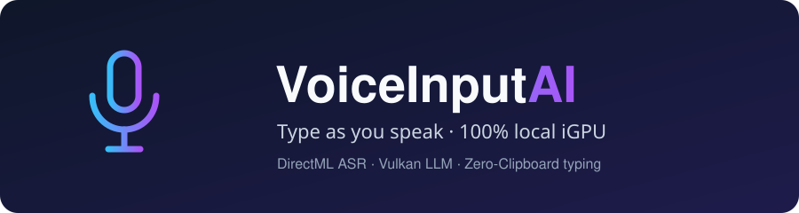
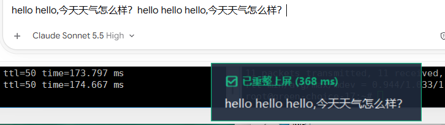
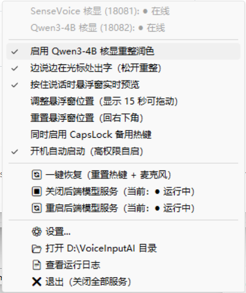
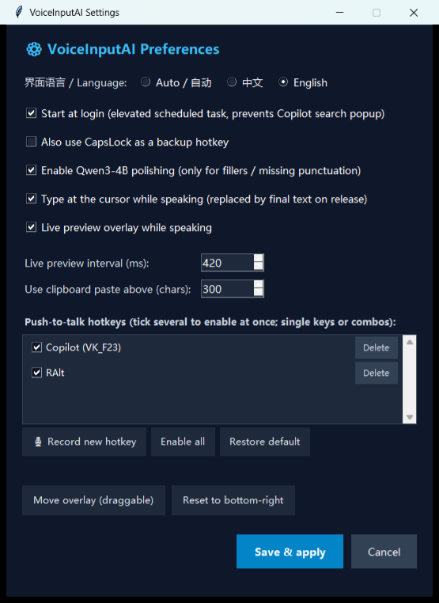

<div align="center">



**Hold a hotkey and talk. Text appears at your cursor in real time. Runs entirely on your local iGPU: offline, free, and it never touches your clipboard.**

[简体中文](README.md) · **English**


</div>

---

## 📸 Screenshots

<table>
<tr>
<td width="50%" align="center"><b>Live typing, then a final polish on release</b><br></td>
<td width="50%" align="center"><b>Tray menu: status at a glance</b><br></td>
</tr>
</table>

> Left: dictating "hello hello hello, 今天天气怎么样？" into an input box. Text appears at the cursor as you speak, and the overlay shows "已重整上屏 (368 ms)" (final text applied in 368 ms).
> Right: the tray menu shows the online status of both backends, plus one-click recovery and start/stop/restart.

<table>
<tr>
<td width="50%" align="center"><b>Settings (English)</b><br></td>
<td width="50%" align="center"><b>设置窗口（中文）</b><br></td>
</tr>
</table>

> The tray menu, settings window and overlay messages come in English and Chinese. Switch under **Interface language** in Settings; the default follows your Windows display language.

> [!NOTE]
> Only the interface is bilingual. Speech recognition is run with the language fixed to Chinese (`lid=zh`), and the polishing prompt and filler-word rules are written for Chinese text. Log files are also written in Chinese.

## 💡 Use cases

**① Mixed Chinese/English dictation, straight into any app**
Hold the hotkey in an IDE, terminal, browser, or chat app. Text shows up at the cursor with no window switching and no pasting.

**② Filler-word removal and punctuation** (actual output from the local Qwen3-4B)

| What you said (raw ASR) | What gets typed |
|---|---|
| 嗯那个就是帮我把今天的 api 接口文档发到群里然后顺便 check 一下数据库有没有报错 | 那个就是帮我把今天的 api 接口文档发到群里，然后顺便 check 一下数据库有没有报错。 |
| 呃明天下午三点开个会啊讨论一下 kubernetes 集群升级的事情 | 明天下午三点开个会讨论一下 kubernetes 集群升级的事情。 |
| 我想问一下这个 fakeTCP 的握手流程是不是有问题 | 我想问一下这个 fakeTCP 的握手流程是不是有问题。 |
| 帮我把这个 pull request merge 到 main 分支然后部署一下 | 帮我把这个 pull request merge 到 main 分支然后部署一下。 |

English and technical terms (`api`, `check`, `fakeTCP`, `kubernetes`, `pull request`, `merge`) are kept as spoken. Only filler words and punctuation are touched.

**③ Pick your own hotkey**
Record any single key or combo in Settings: the `Copilot` key, `RAlt`, `CapsLock`, `Ctrl+Space`, and so on. Tick several to enable them at the same time.

**④ Stays up for long sessions**
The mic reconnects after sleep/wake, crashed backends are restarted automatically, and the tray has a one-click recovery if anything gets stuck.

---

## ✨ Features

| | |
|---|---|
| ⚡ **Type as you speak** | Incremental recognition about every 420 ms, typed at the cursor of any window |
| 📋 **Clipboard untouched** | Direct Win32 `SendInput` Unicode typing. Falls back to paste only for very long text |
| 🧠 **Local iGPU dual engine** | SenseVoice (DirectML) for ASR, Qwen3-4B (Vulkan) for on-demand polishing. No discrete GPU needed |
| ✂️ **Restrained AI polish** | Runs only when fillers or missing punctuation are detected. No rewording, English terms untouched |
| ⌨️ **Win11 Copilot key** | Swallows the `Copilot (F23)` event so no search pops up. Multiple hotkeys can be active at once |
| 🛡️ **Self-healing** | Mic auto-reconnect after sleep, backend auto-restart, one-click recovery from the tray |
| 🌐 **Bilingual UI** | Tray, settings and overlay in English or Chinese. Switch in Settings; defaults to your Windows language |

## 🆚 Comparison

| | Cloud subscription tools | Typical offline tools | **VoiceInputAI** |
|---|:---:|:---:|:---:|
| Privacy / cost | Uploaded to cloud · paid | Local · free | **Local · free** |
| When text appears | After you finish | Pasted all at once on release | **While you speak** |
| How text is inserted | Often via clipboard | Often via clipboard | **`SendInput` typing** |
| Acceleration | Cloud | Mostly CPU / CUDA | **iGPU: DirectML + Vulkan** |
| LLM polishing | May rewrite your meaning | Manual trigger | **On demand, minimal edits** |

## 🔧 How it works

```text
Hotkey down ─ WH_KEYBOARD_LL swallows the system key event
  │
  ├─ While speaking (~420 ms) ─▶ SenseVoice (:18081) ─▶ overlay preview + incremental typing at cursor
  │
  └─ Hotkey up ─▶ final recognition
                   ├─ already clean ─────────────────────────┐
                   └─ fillers / no punctuation ─▶ Qwen3-4B (:18082) ─┴─▶ replace in place with final text
```

<details>
<summary><b>Live-typing implementation details</b></summary>

- **Previews never block the final pass**: preview requests use a non-blocking lock and are skipped when the engine is busy, so the final recognition after release never queues.
- **Append-only while held**: no Backspace is sent while the hotkey is still down, so Electron apps don't see `Win+Shift+Backspace` as a shortcut. A prefix diff corrects the text after release.
- **Safer large replacements**: when more than 8 characters must be replaced, it selects them with `Shift+Left` and replaces in one go, avoiding per-character Backspace flicker.
- **No DirectML stalls**: `dml_pad_to=30` fixed-length padding plus a two-pass warm-up avoids operator recompilation for variable-length audio.
- **Overlay bubble**: `WS_EX_NOACTIVATE`, never steals focus, draggable, remembers its position.

</details>

## 🚀 Quick start

**1. Install dependencies**

```bash
pip install -r requirements.txt
```

**2. Download models and frameworks**

| Component | Download | Where to put it |
|---|---|---|
| 🎙️ SenseVoice-Small | [GitHub](https://github.com/FunAudioLLM/SenseVoice) · [ModelScope](https://modelscope.cn/models/iic/SenseVoiceSmall) · [HF](https://huggingface.co/FunAudioLLM/SenseVoiceSmall) | Source model for ONNX export |
| 📦 SenseVoice FP16 ONNX | Export with [SenseVoice-ONNX](https://github.com/HaujetZhao/SenseVoice-ONNX),<br>or extract from a [CapsWriter-Offline release](https://github.com/HaujetZhao/CapsWriter-Offline/releases) bundle | `models/sensevoice/`<br>`SenseVoice-Encoder.fp16.onnx`<br>`SenseVoice-CTC.fp16.onnx`<br>`tokenizer.bpe.model` |
| ⚙️ ONNX Runtime DirectML | [PyPI](https://pypi.org/project/onnxruntime-directml/) · [GitHub](https://github.com/microsoft/onnxruntime) | `pip install onnxruntime-directml` |
| 🧠 Qwen3-4B-Q4_K_M | [HF](https://huggingface.co/Qwen/Qwen3-4B-GGUF) · [direct link](https://huggingface.co/Qwen/Qwen3-4B-GGUF/resolve/main/Qwen3-4B-Q4_K_M.gguf) · [ModelScope](https://modelscope.cn/models/Qwen/Qwen3-4B-GGUF) | `models/Qwen3-4B-Q4_K_M.gguf` (optional) |
| 🔥 llama.cpp (Vulkan) | [Releases](https://github.com/ggml-org/llama.cpp/releases), pick `llama-*-bin-win-vulkan-x64.zip` | `bin/llama/` |

<details>
<summary>Command-line download reference</summary>

```bash
pip install modelscope
modelscope download --model iic/SenseVoiceSmall
git clone https://github.com/HaujetZhao/SenseVoice-ONNX.git
modelscope download --model Qwen/Qwen3-4B-GGUF Qwen3-4B-Q4_K_M.gguf --local_dir ./models
```

</details>

**3. Run**

Double-click [`start_tray.bat`](start_tray.bat). Once the tray icon is ready, hold the hotkey and talk. Right-click the tray icon → **Settings** to record hotkeys, switch the interface language or enable elevated auto-start.

## 📁 Layout

```text
voice_tray_app.py       Tray controller · hotkey hook · live typing · settings window · backend supervisor
sensevoice_server.py    Local SenseVoice DirectML ASR service (:18081)
sensevoice_engine/      Pure-ONNX inference wrapper
scripts/polish_test.py  Polish endpoint test
start_tray.bat          Entry point
```

## 🙏 Credits

[SenseVoice](https://github.com/FunAudioLLM/SenseVoice) · [SenseVoice-ONNX](https://github.com/HaujetZhao/SenseVoice-ONNX) · [llama.cpp](https://github.com/ggml-org/llama.cpp) · [Qwen3](https://huggingface.co/Qwen/Qwen3-4B-GGUF) · [ONNX Runtime](https://github.com/microsoft/onnxruntime)
