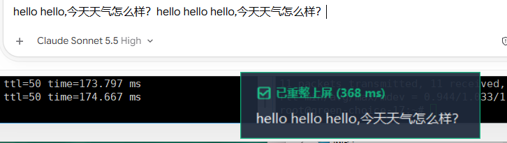
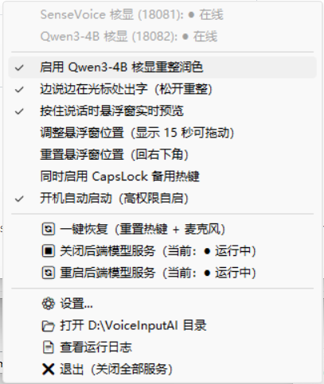
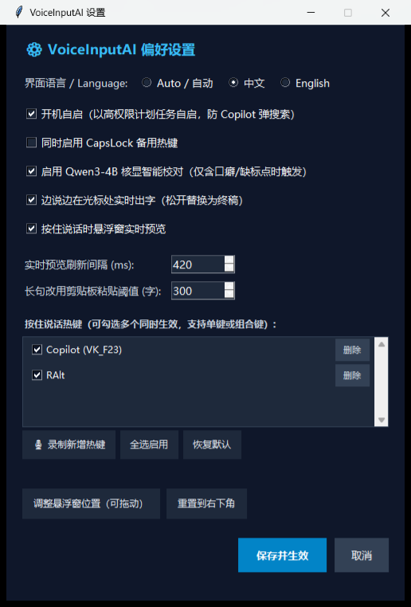
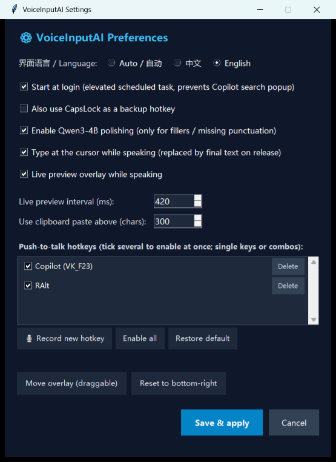

<div align="center">


**按住热键说话，文字实时出现在光标处。全程本地核显运行，不联网、不收费、不动剪贴板。**

**简体中文** · [English](README.en.md)


</div>

---

## 📸 效果展示

<table>
<tr>
<td width="50%" align="center"><b>边说边出字，松手后重整上屏</b><br></td>
<td width="50%" align="center"><b>托盘菜单：状态一目了然</b><br></td>
</tr>
</table>

> 左图：对着输入框说「hello hello hello，今天天气怎么样？」，文字在光标处实时出现，悬浮窗显示「已重整上屏 (368 ms)」。
> 右图：托盘菜单显示两个后端的在线状态，可一键恢复、启停和重启服务。

<table>
<tr>
<td width="50%" align="center"><b>设置窗口（中文）</b><br></td>
<td width="50%" align="center"><b>Settings (English)</b><br></td>
</tr>
</table>

> 托盘菜单、设置窗口和悬浮提示都有中文 / English 两套界面，在设置里的「界面语言」切换，默认跟随 Windows 显示语言。

## 💡 使用案例

**① 中英混说，直接上屏**
在 IDE、终端、浏览器、微信、聊天框里按住热键说话，文字实时出现在光标处，不切窗口、不粘贴。

**② 自动去口癖、补标点**（以下为本地 Qwen3-4B 的实测输出）

| 你说的（识别原文） | 上屏结果 |
|---|---|
| 嗯那个就是帮我把今天的 api 接口文档发到群里然后顺便 check 一下数据库有没有报错 | 那个就是帮我把今天的 api 接口文档发到群里，然后顺便 check 一下数据库有没有报错。 |
| 呃明天下午三点开个会啊讨论一下 kubernetes 集群升级的事情 | 明天下午三点开个会讨论一下 kubernetes 集群升级的事情。 |
| 我想问一下这个 fakeTCP 的握手流程是不是有问题 | 我想问一下这个 fakeTCP 的握手流程是不是有问题。 |
| 帮我把这个 pull request merge 到 main 分支然后部署一下 | 帮我把这个 pull request merge 到 main 分支然后部署一下。 |

英文和技术词（`api`、`check`、`fakeTCP`、`kubernetes`、`pull request`、`merge`）原样保留，只做去口癖和补标点。

**③ 换热键，适配自己的习惯**
设置里可录制 `Copilot` 键、`RAlt`、`CapsLock` 或 `Ctrl+Space` 等任意单键/组合键，并**勾选多个同时生效**。

**④ 长时间使用不掉线**
笔记本休眠唤醒后麦克风自动重连；后端意外退出自动拉起；万一卡住，托盘点「一键恢复」。

---

## ✨ 特性

| | |
|---|---|
| ⚡ **边说边出字** | 说话时约每 420ms 增量识别，直接在任意窗口的光标处上屏 |
| 📋 **不动剪贴板** | 通过 Win32 `SendInput` Unicode 直写；仅超长文本才回退为粘贴 |
| 🧠 **本地核显双引擎** | SenseVoice（DirectML）识别 + Qwen3-4B（Vulkan）按需校对，无需独立显卡 |
| ✂️ **克制的 AI 校对** | 只在含口癖或缺标点时触发；不改用词、不动英文术语 |
| ⌨️ **Win11 Copilot 键** | 硬件级吞掉 `Copilot (F23)` 事件，不弹搜索；支持多热键同时生效 |
| 🛡️ **自愈** | 休眠唤醒自动重连麦克风，后端掉线自动拉起，托盘一键恢复 |
| 🌐 **中英双语界面** | 托盘、设置、悬浮提示支持中文 / English，设置里一键切换，默认跟随系统语言 |

## 🆚 对比

| | 云端订阅工具 | 常见离线工具 | **VoiceInputAI** |
|---|:---:|:---:|:---:|
| 隐私 / 成本 | 上传云端 · 付费 | 本地 · 免费 | **本地 · 免费** |
| 出字时机 | 说完后返回 | 松手后一次性贴出 | **说话时实时出字** |
| 上屏方式 | 多借剪贴板 | 多借剪贴板 | **SendInput 直写** |
| 加速硬件 | 云端 | 多为 CPU / CUDA | **核显 DirectML + Vulkan** |
| LLM 校对 | 易改写原意 | 手动触发 | **按需、最小改动** |

## 🔧 工作原理

```text
按下热键 ─ WH_KEYBOARD_LL 吞掉系统按键
  │
  ├─ 说话中（~420ms）─▶ SenseVoice (:18081) ─▶ 悬浮预览 + 光标处增量追加
  │
  └─ 松开热键 ─▶ 最终识别
                  ├─ 已完整 ─────────────────────────┐
                  └─ 含口癖 / 缺标点 ─▶ Qwen3-4B (:18082) ─┴─▶ 原地替换为终稿
```

<details>
<summary><b>实时出字的实现细节</b></summary>

- **预览不阻塞终稿**：预览请求用非阻塞锁，引擎忙时直接跳过，松手后的最终识别不排队。
- **按住期间只追加**：热键仍按下时不发送退格，避免 Electron 把 `Win+Shift+Backspace` 当快捷键；松手后再做前缀差分修正。
- **大段替换更稳**：需替换超过 8 个字符时，用 `Shift+Left` 批量选区一次性替换，避免逐字退格的闪烁。
- **DirectML 防卡顿**：`dml_pad_to=30` 定长填充并双轮预热，避免变长音频反复重编译算子。
- **悬浮气泡**：`WS_EX_NOACTIVATE`，不抢焦点，可拖动并记忆位置。

</details>

## 🚀 快速开始

**1. 安装依赖**

```bash
pip install -r requirements.txt
```

**2. 下载模型与框架**

| 组件 | 下载 | 放置位置 |
|---|---|---|
| 🎙️ SenseVoice-Small | [GitHub](https://github.com/FunAudioLLM/SenseVoice) · [ModelScope](https://modelscope.cn/models/iic/SenseVoiceSmall) · [HF](https://huggingface.co/FunAudioLLM/SenseVoiceSmall) | 导出 ONNX 用 |
| 📦 SenseVoice FP16 ONNX | 导出：[SenseVoice-ONNX](https://github.com/HaujetZhao/SenseVoice-ONNX)<br>或从 [CapsWriter-Offline Releases](https://github.com/HaujetZhao/CapsWriter-Offline/releases) 整合包提取 | `models/sensevoice/`<br>`SenseVoice-Encoder.fp16.onnx`<br>`SenseVoice-CTC.fp16.onnx`<br>`tokenizer.bpe.model` |
| ⚙️ ONNX Runtime DirectML | [PyPI](https://pypi.org/project/onnxruntime-directml/) · [GitHub](https://github.com/microsoft/onnxruntime) | `pip install onnxruntime-directml` |
| 🧠 Qwen3-4B-Q4_K_M | [HF](https://huggingface.co/Qwen/Qwen3-4B-GGUF) · [直链](https://huggingface.co/Qwen/Qwen3-4B-GGUF/resolve/main/Qwen3-4B-Q4_K_M.gguf) · [ModelScope](https://modelscope.cn/models/Qwen/Qwen3-4B-GGUF) | `models/Qwen3-4B-Q4_K_M.gguf`（可选） |
| 🔥 llama.cpp (Vulkan) | [Releases](https://github.com/ggml-org/llama.cpp/releases)，选 `llama-*-bin-win-vulkan-x64.zip` | `bin/llama/` |

<details>
<summary>命令行下载参考</summary>

```bash
pip install modelscope
modelscope download --model iic/SenseVoiceSmall
git clone https://github.com/HaujetZhao/SenseVoice-ONNX.git
modelscope download --model Qwen/Qwen3-4B-GGUF Qwen3-4B-Q4_K_M.gguf --local_dir ./models
```

</details>

**3. 启动**

双击 [`start_tray.bat`](start_tray.bat)。托盘图标就绪后，按住热键即可说话；右键托盘 → **设置** 可录制热键、开启高权限开机自启。

## 📁 目录

```text
voice_tray_app.py       托盘主控 · 热键钩子 · 实时上屏 · 设置窗口 · 后端托管
sensevoice_server.py    SenseVoice DirectML 本地 ASR 服务 (:18081)
sensevoice_engine/      纯 ONNX 推理封装
scripts/polish_test.py  润色接口测试
start_tray.bat          启动入口
```

## 🙏 致谢

[SenseVoice](https://github.com/FunAudioLLM/SenseVoice) · [SenseVoice-ONNX](https://github.com/HaujetZhao/SenseVoice-ONNX) · [llama.cpp](https://github.com/ggml-org/llama.cpp) · [Qwen3](https://huggingface.co/Qwen/Qwen3-4B-GGUF) · [ONNX Runtime](https://github.com/microsoft/onnxruntime)
